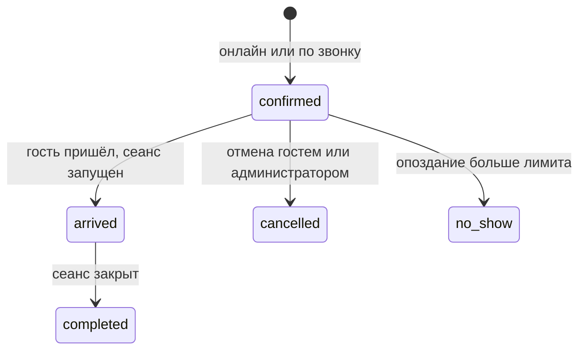

# Сценарии пользователей

Роли описаны в `docs/PRD.md`, таблицы и функции в `docs/DATABASE.md`.

## Владелец

### 1. Подключение заведения

Регистрации нет: заведения подключает владелец платформы в кабинете `/admin`.

1. Владелец платформы нажимает «Подключить заведение» и вводит email владельца заведения и название организации. Если у владельца уже есть организация, заведение добавляется в неё.
2. Заполняет профиль заведения: тип, название, город, адрес, телефон, часы работы. День может быть выходным, ночным (закрытие раньше открытия) или круглосуточным; «Круглосуточно, без выходных» отмечает всю неделю.
3. Система предлагает slug из названия латиницей, его можно поменять. Занятый или зарезервированный slug не принимается.
4. Владелец заведения получает приглашение на email, задаёт пароль по ссылке и видит заведение в списке. Если он уже есть в системе, заведение просто появляется после входа.
5. Владелец заведения открывает настройки со списком шагов: карта зала, тарифы, правила брони, фото, публикация. Профиль и часы он правит сам.
6. Владелец платформы видит в `/admin` все заведения: владельца, публикацию и готовность настройки (часы, места, тарифы, фото, сотрудники). Выручку, оплаты, отчёты, брони и гостей он не видит.

Публичная страница не открывается, пока владелец не нажмёт «Опубликовать». Кнопка недоступна, если нет хотя бы одного ресурса и одного тарифа.

### 2. Карта зала

1. Владелец открывает редактор, создаёт зал или выбирает существующий.
2. Добавляет ресурсы из панели. Набор видов зависит от типа заведения: бильярду — столы пул и русские, PS-клубу — PS-зоны.
3. Перетаскивает, вращает, меняет размер. Фигуры прилипают к сетке.
4. У ресурса задаёт название, вместимость, «доступен для онлайн-брони».
5. Добавляет декор: бар, вход, стены, подписи.
6. Сохраняет. Удалить ресурс, у которого есть сеансы или брони, нельзя: его можно только выключить.

### 3. Тарифы

1. Владелец создаёт тариф: название, виды ресурсов, цена за час, дни недели, время с и до.
2. Ночной тариф с 22:00 до 06:00 вводится как есть: система понимает переход через полночь.
3. Система показывает сетку недели по каждому виду ресурса и подсвечивает часы работы, где тариф не задан. Сеанс в такие часы не закроется.
4. При желании создаёт пакеты: «3 часа за 5 000 ₸».

### 4. Правила брони

Владелец задаёт шаг слота, минимальную длительность, буфер между бронями, за сколько минут до начала и на сколько дней вперёд можно бронировать онлайн, через сколько минут опоздания бронь становится неявкой. Онлайн-бронь можно выключить, оставив публичную страницу с информацией.

### 5. Сотрудники

1. Владелец в «Настройки → Сотрудники» добавляет администратора: имя, логин (латиницей) и пароль. Email не нужен.
2. Владелец передаёт логин и пароль сотруднику. Забытый пароль владелец меняет там же — «Сменить пароль».
3. Администратор входит по логину вместо email. Он видит рабочие экраны, но не настройки, отчёты, журнал действий и аннулирование сеансов.
4. Удалённый сотрудник теряет доступ сразу.

### 6. Отчёты и контроль

1. Владелец выбирает период.
2. Видит выручку по дням, по ресурсам и по способам оплаты, загрузку каждого ресурса в процентах от часов работы, число неявок.
3. Выгружает данные в CSV.
4. В журнале действий видит, кто и когда аннулировал сеанс, правил время, давал скидку, отменял оплату.
5. В «Отчётах» — смены за период: кто открыл и закрыл, сколько наличных ожидалось и сколько пересчитали. Недостача — красным.

### 6а. Заведение со своей кассой iiko

1. Владелец в «Настройки → Интеграция» отмечает «Только онлайн-бронь»: в меню остаются обзор, брони, журнал и настройки; смены сотрудники не открывают.
2. Вводит ключ API iiko, выбирает организацию, группу терминалов и залы → «Загрузить столы и включить обмен». Столы iiko появляются местами на схеме, расставить их можно в редакторе карты.
3. Гость на странице брони не видит времени, на которое стол занят бронью в iiko.
4. Бронь с сайта или по звонку сразу появляется в iiko; отмена и неявка отменяют её там. Брони, которые не ушли в iiko, владелец видит в «Интеграции».

## Администратор

### 7. Открытие смены

1. Администратор входит по логину. С одним заведением он сразу попадает в него.
2. Если смена не открыта, вместо рабочих экранов — «Начало смены»: администратор пересчитывает наличные в кассе и вводит сумму. Без открытой смены администратор не работает. Можно выйти, не открывая смену.
3. Если смену уже открыл другой администратор, вход сразу ведёт к работе.
4. Владелец смену не открывает обязательно: без смены он может запускать столы, но не принимать оплату.

### 8. Гость без брони

1. На карте зала администратор нажимает на свободный стол.
2. Если на этом столе скоро бронь, видит предупреждение: «Бронь в 20:00, стол свободен 1 ч 20 мин».
3. Выбирает тариф на время («1 час — 1 500 ₸», «3 часа — 4 000 ₸») или «Поминутно» с ожидаемым окончанием, по желанию — имя и телефон гостя, и нажимает «Старт». Тариф сам задаёт время окончания и цену.
4. Стол на карте становится занятым, идёт таймер и текущая сумма. Сумма обновляется раз в минуту из `calc_session_amount`.

Без ожидаемого окончания стол закрыт для онлайн-брони, пока сеанс не остановят.

### 9. Гость пришёл по брони

1. Администратор открывает бронь в ленте или на карте, нажимает «Пришёл».
2. Бронь превращается в сеанс на этом столе с ожидаемым окончанием из брони.

### 10. Пауза и перенос

- «Пауза» останавливает отсчёт денег, стол остаётся занятым. «Продолжить» возобновляет.
- «Перенести» открывает выбор свободного стола. Время до переноса считается по тарифу старого стола, после — по тарифу нового. Чек один.

### 11. Закрытие сеанса и оплата

1. Администратор нажимает «Стоп».
2. Видит чек: время по тарифам, товары, скидку, итог.
3. Добавляет товары, если не добавил раньше. Вводит скидку при необходимости.
4. Принимает оплату на месте и отмечает способ: наличные, Kaspi, карта. Можно разделить на несколько способов.
5. Нажимает «Закрыть». Стол освобождается.

### 12. Бронь по звонку

1. Администратор открывает ленту броней, выбирает стол и время.
2. Вводит имя и телефон гостя, число гостей, комментарий.
3. Бронь сразу подтверждена.
4. Если время занято, база отказывает, и администратор видит, с какой бронью пересечение.

### 13. Новая онлайн-бронь

1. В админке появляется уведомление со звуком: новая бронь, стол, время, имя и телефон гостя.
2. Рядом с гостем видно, сколько раз он раньше не пришёл.
3. Если бронь подозрительная, администратор может позвонить гостю или отменить бронь с причиной.

### 14. Закрытие смены

1. Вместо «Выйти» у администратора с открытой сменой кнопка «Закрыть смену». Она ведёт на «Конец смены»: администратор вводит наличные в кассе.
2. Видит сумму по системе, в кассе и разницу, затем нажимает «Выйти».
3. Если смену продолжает другой администратор, можно «Выйти, смену не закрывать».
4. Открытые сеансы закрытию смены не мешают: их оплата попадёт в следующую смену.

## Гость

### 15. Бронь по ссылке

1. Гость открывает ссылку заведения из Instagram, 2ГИС или WhatsApp.
2. Видит фото (листает свайпом), название, адрес со ссылкой на 2ГИС, часы работы, цены, правила.
3. Нажимает «Забронировать». Бронь идёт по шагам: «Дата и время» → «Место» → «Контакты».
4. Шаг «Дата и время»: день из ленты, тариф на время (или «Своё время» с длительностью) и время начала. У каждого времени видно, сколько мест свободно. «Выбрать место».
5. Шаг «Место»: схема зала, свободные на это время места зелёные, занятые серые, выбранное — красное. Под схемой тот же выбор списком. «Далее».
6. Шаг «Контакты»: имя, телефон, число гостей, комментарий.
7. Видит правила: оплата на месте, бронь держится N минут после начала. Ставит галочку согласия на обработку персональных данных.
8. Проходит проверку Turnstile и нажимает «Забронировать».
9. Бронь сразу подтверждена. Гость получает страницу с кодом брони и личной ссылкой `/b/{token}`. Ссылку стоит сохранить: по ней бронь можно посмотреть и отменить.

### 16. Отмена гостем

1. Гость открывает `/b/{token}` и нажимает «Отменить».
2. Подтверждает отмену. Стол освобождается, администратор видит отмену в ленте.

Отменить можно до времени начала брони.

### 17. Опоздание и неявка

- Гость опаздывает меньше `no_show_after_min` — бронь ждёт, администратор отмечает «Пришёл».
- Опоздал больше — система переводит бронь в «Не пришёл». Стол освобождается для гостей без брони. Неявка засчитывается гостю и видна администратору в его следующих бронях.

## Статусы брони

Брони в статусах `confirmed` и `arrived` занимают ресурс. Остальные статусы ресурс не занимают.
